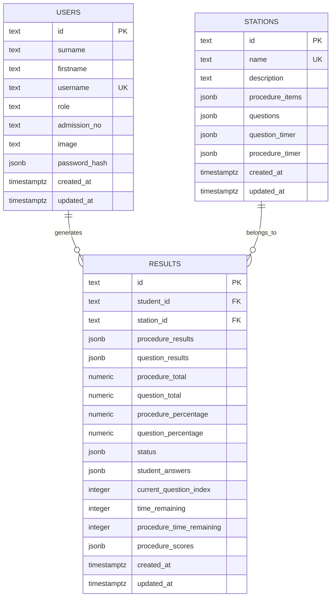

# Database Design

## Overview

OSCII_MS stores persistent data in PostgreSQL. The database is initialized by
the backend on startup if the required tables do not exist.

Core tables:

- `users`
- `stations`
- `results`

## Tabular Summary

| Table | Purpose | Primary Key | Main Data Stored | Key Constraints / Relations |
| --- | --- | --- | --- | --- |
| `users` | Stores application accounts for admins, moderators, and students | `id` | Identity details, role, admission number, profile image, password hash | `username` is unique; password is stored as PBKDF2 hash record |
| `stations` | Stores assessment stations and their configuration | `id` | Station name, description, questions, procedure items, timers | `name` is unique; nested assessment content is stored in JSONB |
| `results` | Stores assessment attempts and scores for each student-station pair | `id` | Scores, completion status, saved answers, timer state, totals, percentages | `student_id` references `users.id`; `station_id` references `stations.id`; `(student_id, station_id)` is unique |

## Entity Relationship Diagram

## Table Details

### `users`

Purpose:

- Stores all application users
- Supports admin, moderator, and student roles

Important fields:

- `id`: primary key, generated UUID-like identifier
- `username`: unique login name
- `role`: access level used by the backend and frontend routing
- `admission_no`: populated for student accounts
- `password_hash`: JSONB object containing the password hash record

Password hash structure:

- `salt`
- `hash`
- `iterations`
- `digest`

#### Column Dictionary

| Column | Type | Required | Description |
| --- | --- | --- | --- |
| `id` | text | Yes | Unique identifier for the user record |
| `surname` | text | Yes | User surname |
| `firstname` | text | Yes | User first name |
| `username` | text | Yes | Login username |
| `role` | text | Yes | User role such as `admin`, `moderator`, or `student` |
| `admission_no` | text | No | Student admission number |
| `image` | text | No | Profile image path or data URI |
| `password_hash` | jsonb | Yes | PBKDF2 password record |
| `created_at` | timestamptz | Yes | Record creation timestamp |
| `updated_at` | timestamptz | Yes | Record update timestamp |

### `stations`

Purpose:

- Stores assessment stations and their embedded configuration

Important fields:

- `name`: unique station title
- `description`: station summary
- `procedure_items`: array of checklist items
- `questions`: array of multiple-choice questions
- `question_timer`: timer config for question assessments
- `procedure_timer`: timer config for procedure assessments

Expected nested shapes:

- Procedure item:
  - `id`
  - `description`
  - `scoreOptions`
- Question:
  - `id`
  - `description`
  - `options`
  - `answer`
  - `mark`
- Timer:
  - `enabled`
  - `duration`

#### Column Dictionary

| Column | Type | Required | Description |
| --- | --- | --- | --- |
| `id` | text | Yes | Unique identifier for the station |
| `name` | text | Yes | Station title |
| `description` | text | No | Station description |
| `procedure_items` | jsonb | Yes | Array of procedure checklist items |
| `questions` | jsonb | Yes | Array of multiple-choice questions |
| `question_timer` | jsonb | Yes | Question timer configuration |
| `procedure_timer` | jsonb | Yes | Procedure timer configuration |
| `created_at` | timestamptz | Yes | Record creation timestamp |
| `updated_at` | timestamptz | Yes | Record update timestamp |

### `results`

Purpose:

- Stores one assessment record per student per station

Important fields:

- `student_id`: references `users.id`
- `station_id`: references `stations.id`
- `procedure_results`: scored checklist entries
- `question_results`: scored question entries
- `status`: JSONB status object for procedure and question completion
- `student_answers`: map of question id to selected answer
- `procedure_scores`: map of procedure item id to selected score
- `time_remaining`: question assessment countdown
- `procedure_time_remaining`: procedure assessment countdown

Constraints:

- `UNIQUE(student_id, station_id)` prevents duplicate result rows for the same
  student and station pair
- Foreign keys use `ON DELETE CASCADE`

#### Column Dictionary

| Column | Type | Required | Description |
| --- | --- | --- | --- |
| `id` | text | Yes | Unique identifier for the result record |
| `student_id` | text | Yes | References the student user record |
| `station_id` | text | Yes | References the station record |
| `procedure_results` | jsonb | Yes | Stored procedure scoring entries |
| `question_results` | jsonb | Yes | Stored question scoring entries |
| `procedure_total` | numeric | Yes | Sum of procedure scores |
| `question_total` | numeric | Yes | Sum of question scores |
| `procedure_percentage` | numeric | Yes | Procedure percentage score |
| `question_percentage` | numeric | Yes | Question percentage score |
| `status` | jsonb | Yes | Completion status for procedure and question flows |
| `student_answers` | jsonb | Yes | Selected answers keyed by question id |
| `current_question_index` | integer | Yes | Current question position during assessment |
| `time_remaining` | integer | No | Countdown value for question assessment |
| `procedure_time_remaining` | integer | No | Countdown value for procedure assessment |
| `procedure_scores` | jsonb | Yes | Selected rubric scores keyed by procedure item id |
| `created_at` | timestamptz | Yes | Record creation timestamp |
| `updated_at` | timestamptz | Yes | Record update timestamp |

## Data Handling Notes

- The backend reads and writes JSONB columns as structured JavaScript objects
  and arrays.
- `readDb()` returns normalized JS objects.
- `writeDb()` replaces the full table contents from a sanitized snapshot.
- Deleting a user or station also removes related result rows.

## Seed Data

On first launch, if the database is empty, the backend seeds an admin account:

- username: `admin`
- password: `admin123`

The password can be overridden with `BOOTSTRAP_ADMIN_PASSWORD`.
