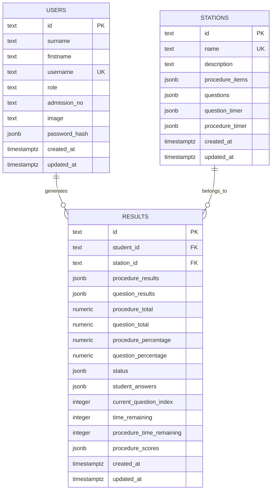

# Entity Relation Diagram

This file contains the entity-relationship diagram for the current OSCII_MS database schema.

## ERD

## Relationship Summary

| Relationship | Type | Meaning |
| --- | --- | --- |
| `users` -> `results` | One-to-many | `users` is a parent table and `results` is the child table for student assessment records |
| `stations` -> `results` | One-to-many | `stations` is a parent table and `results` is the child table for station assessment records |

## Notes

- `users.id`, `stations.id`, and `results.id` are primary key columns
- `results.student_id` is a foreign key that references `users.id`
- `results.station_id` is a foreign key that references `stations.id`
- The backend enforces `UNIQUE(student_id, station_id)`
- Assessment content remains embedded in `stations` as JSONB arrays
- In write-up terms, `results` is the dependent or child entity because each row depends on one user and one station
