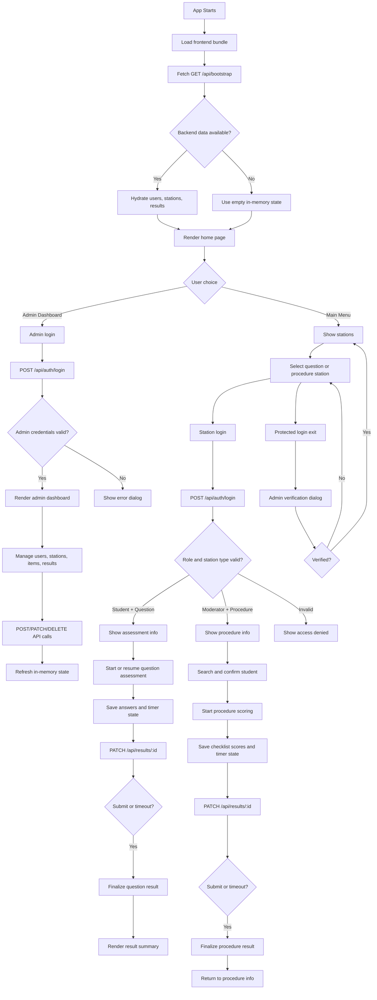

# Flowchart

## Reading Guide

- The top half describes app startup and hydration.
- The middle branch shows the three role paths.
- The bottom branch shows the protected return flow from question/procedure
  login screens back to the main menu.

