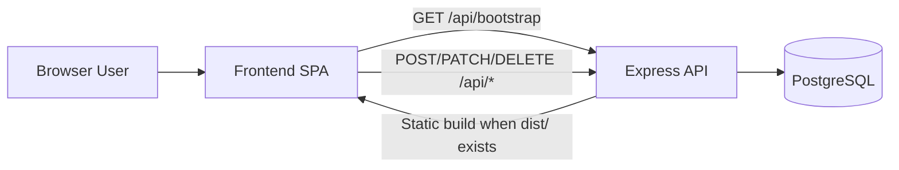

# System Design

## Overview

OSCII_MS is a browser-based clinical assessment system with two layers:

- A Webpack-built frontend SPA
- An Express + PostgreSQL backend API

The backend is the source of truth for persistent data. The frontend hydrates
its in-memory stores from the backend snapshot on startup and sends mutations
back through authenticated API calls.

## Architecture

## Main Components

### Frontend

- Entry point: `src/index.js`
- UI screens: `src/dashboard/*.js`
- Client data layer: `src/app/*.js`
- Session and auth token storage: browser `localStorage`
- Bundling: Webpack 5 with `webpack-dev-server`

Responsibilities:

- Render the home page, login page, admin dashboard, student dashboard, and
  examiner dashboard
- Hydrate users, stations, and results from `GET /api/bootstrap`
- Send authenticated CRUD requests to the backend
- Maintain in-progress assessment state in memory and sync it to the backend

### Backend

- Entry point: `backend/src/server.js`
- Express app setup: `backend/src/app.js`
- Routes: `backend/src/routes/index.js`
- Database access: `backend/src/store/db.js`
- Auth helpers: `backend/src/lib/auth.js`
- CSV export helper: `backend/src/lib/csv.js`

Responsibilities:

- Create or connect to PostgreSQL
- Create schema tables if they do not exist
- Seed a default admin user when the database is empty
- Authenticate users and issue bearer tokens
- Enforce role-based access control
- Persist stations, users, and results
- Export station results as CSV

### Database

Tables:

- `users`
- `stations`
- `results`

The database uses JSONB for nested structures such as:

- station questions
- station procedure items
- timer settings
- result status and answer maps

## Runtime Flow

1. The frontend loads `GET /api/bootstrap`.
2. If backend data exists, the frontend hydrates in-memory collections for
   users, stations, and results.
3. The user chooses a login path from the home screen or main menu.
4. The frontend authenticates against `POST /api/auth/login`.
5. The backend returns a bearer token and sanitized user object.
6. The frontend stores the token in `oscii_auth_token`.
7. Depending on role and station type:
   - Admins enter the admin dashboard
   - Students enter the question assessment flow
   - Moderators enter the procedure assessment flow
8. During assessment, the frontend updates the result object and syncs it to
   `PATCH /api/results/:id`.
9. Admin actions such as creating stations, users, questions, or procedure
   items are posted to backend endpoints and reflected back into local state.

## Authentication and Authorization

- Login endpoint: `POST /api/auth/login`
- Token validation: HMAC-signed bearer token
- Token storage: `localStorage` key `oscii_auth_token`
- Role checks:
  - Admin-only routes reject non-admin users
  - Station and result read routes require authentication

The frontend also adds a protected return flow for question and procedure login
screens. Leaving those screens requires an admin verification dialog.

## Assessment Flows

### Student Question Flow

- Student logs in with a station and question type
- Assessment information is shown
- Student answers questions one at a time
- Answers are stored in the result object
- Timer, if enabled, counts down from the station configuration
- Submission or timeout finalizes the question score and syncs the result

### Moderator Procedure Flow

- Moderator logs in to a procedure station
- Moderator searches for a student by admission number
- Student identity is confirmed before assessment starts
- Procedure checklist items are scored one by one
- Timer, if enabled, counts down from the station configuration
- Submission or timeout finalizes the procedure score and syncs the result

### Admin Flow

- Admin logs in using the admin login path
- Admin can manage stations, users, questions, procedure items, and results
- CSV import is available for bulk uploads
- Station results can be refreshed and downloaded as CSV

## Key Files

- [Frontend bootstrap](../src/index.js)
- [Login routing](../src/dashboard/loginPage.js)
- [Admin dashboard](../src/dashboard/adminDashboard.js)
- [Question assessment](../src/dashboard/studentDashboard.js)
- [Procedure assessment](../src/dashboard/examinerDashboard.js)
- [Backend server](../backend/src/server.js)
- [Backend routes](../backend/src/routes/index.js)
- [Database store](../backend/src/store/db.js)

